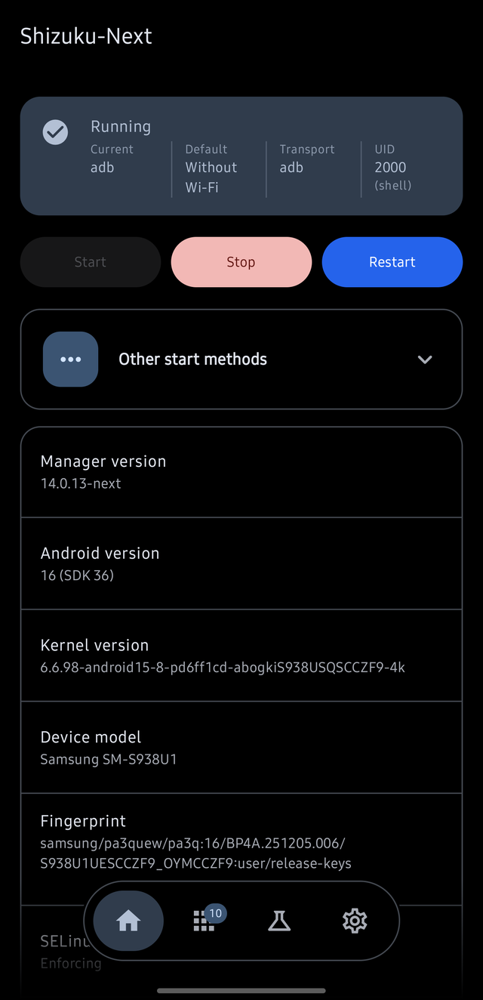
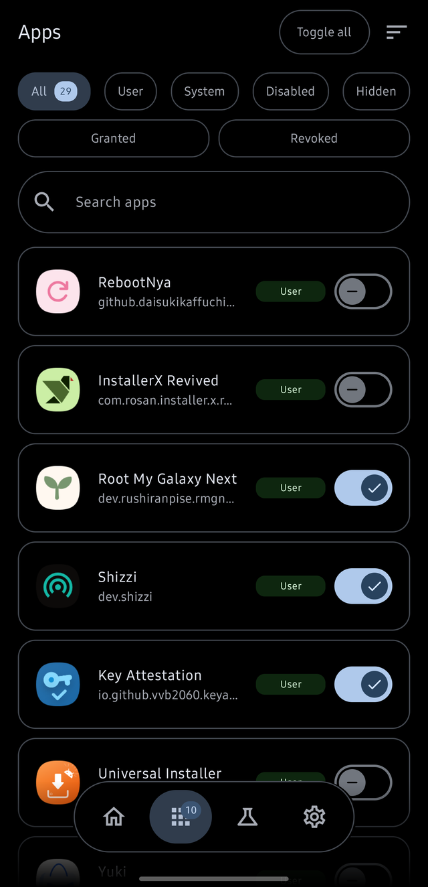
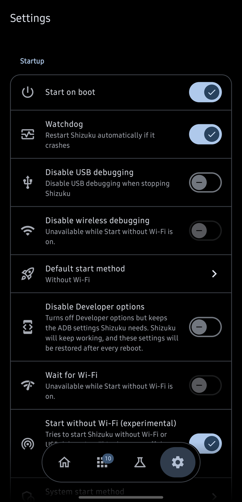

<div align="center">


# Shizuku-HyperNext

基于 Shizuku-Next 的二次开发版本：保持 Shizuku 的 ADB/Root 系统 API 能力与包名不变，
将 Manager 界面层迁移到 MIUIX 0.9.5 的玻璃（Glass）组件。





</div>

## 关于本项目 / About

本项目是 [Shizuku-Next](https://github.com/rushiranpise/Shizuku-Next) 的衍生版本，而 Shizuku-Next 本身又是 [thedjchi's Shizuku fork](https://github.com/thedjchi/Shizuku) 的衍生版本，最初源自 [RikkaApps/Shizuku](https://github.com/RikkaApps/Shizuku)。

完整的来源链：

```
RikkaApps/Shizuku  →  thedjchi/Shizuku  →  rushiranpise/Shizuku-Next  →  Sennagi/Shizuku-HyperNext
（原版 Shizuku）      （社区分支）            （增强分支）                  （本项目）
```

本项目保留了 Shizuku 的包名与 API，兼容原本依赖 Shizuku 的应用。在本项目上的主要改动：

- Manager 端界面层迁移到 MIUIX KMP 组件（0.9.5-beta01），包括玻璃顶栏、玻璃下拉菜单等；
- 顶栏图标下拉使用官方 `GlassIconDropdownMenu` + `GlassPopupAnchor` 链路，而非自绘弹窗。

> **重要**：本项目使用与官方 Shizuku 不同的签名密钥。安装前请先卸载官方 Shizuku 或其他分支版本。旧版本启动的服务可能仍然运行，需要手动停止或重启设备。

如需原版应用，请访问 [RikkaApps/Shizuku](https://github.com/RikkaApps/Shizuku)。

## 下载 / Download

从本项目 [Releases](https://github.com/Sennagi/Shizuku-HyperNext/releases) 获取最新构建。

## 功能 / Features

沿用 Shizuku-Next 的能力：ADB 无线调试 / USB / Root / Samsung FOTA 系统 UID 等方式启动，应用授权管理，App Ops、电池与网络管理，内置 Shell、日志查看、文件浏览、应用安装器，防火墙，ADB 模块，Android TV / VR 界面适配等。完整功能说明见 [上游 README](https://github.com/rushiranpise/Shizuku-Next#features)。

部分功能为实验性或依赖具体设备/ROM。

## 系统要求 / Requirements

- Android 7.0 或更高版本
- 无线调试启动：Android 11+；USB/PC 启动需要电脑上的 ADB；Root 启动需要可用的 root 权限

更多设置与排障说明见 [上游 Wiki](https://github.com/thedjchi/Shizuku/wiki)。

## 隐私 / Privacy

- 无追踪、无统计、无遥测、无专有库
- 不依赖 Google Play Services
- 开源，支持可复现构建
- 联网仅用于无线调试连接、检查/下载 GitHub 更新、读取 GitHub 上的模块列表

## 构建 / Build

```bash
git clone --recurse-submodules https://github.com/Sennagi/Shizuku-HyperNext.git
cd Shizuku-HyperNext
./gradlew :manager:assembleRelease
```

产物：`manager/build/outputs/apk/release/`。

## 贡献 / Contributing

1. Fork 本仓库
2. 创建功能分支
3. 修改并测试
4. 提交并推送
5. 发起 Pull Request

## 致谢 / Credits

- [RikkaW / RikkaApps](https://github.com/RikkaApps/Shizuku) — 原版 Shizuku、Server 与 API
- [thedjchi](https://github.com/thedjchi/Shizuku) — 上游分支及其大量特性
- [rushiranpise](https://github.com/rushiranpise/Shizuku-Next) — Shizuku-Next 的维护与增强
- [MIUIX](https://github.com/compose-miuix-ui/miuix) — Manager 端使用的 KMP 组件库
- 所有上游贡献者与 Crowdin 翻译者

## 许可证 / License

本项目沿用上游的 [Apache License 2.0](LICENSE)。
